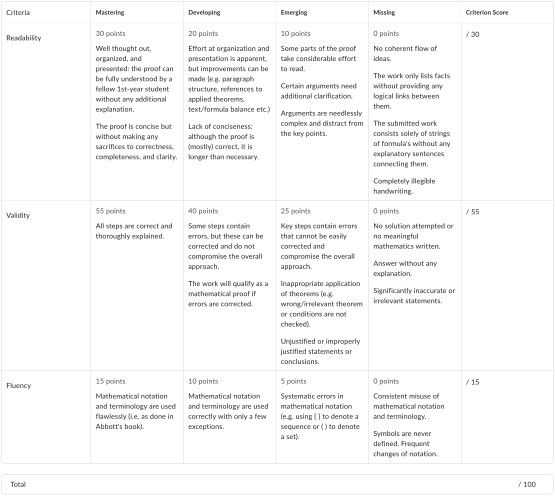

# Analysis (WBMA012-05) — Course Information 2026–2027

**Marcello Seri** — Bernoulliborg, room 484 — m.seri@rug.nl

> **Calendar:** Dates, times and rooms follow the [2026–2027 RUG rooster](https://rooster.rug.nl/current?courseOffering=WBMA012-05.2026-2027.1). Check the live rooster for changes. The allocation of teaching topics and tutorial exercises remains provisional after lecture 9.

---

## Contents

1. [Assessment](#assessment)
2. [Communications and code of conduct](#communications-and-code-of-conduct)
3. [Course schedule](#course-schedule)
4. [Homework assignments](#homework-assignments)
5. [Supplements to the book](#supplements-to-the-book)
6. [Hints for selected exercises](#hints-for-selected-exercises)

---

# Assessment

Please read this section very carefully since it provides important information on when and how you will be assessed.

## Important dates

All times are local Groningen time.

| Date | Time | Event | Room |
|---|---|---|---|
| Fri 13 November 2026 | 09:00–11:00 | Waterproof proof-writing workshop (introductory lab; no homework deadline) | 5161.0105 |
| Fri 20 November 2026 | 09:00–11:00 | Homework 1 deadline; peer review and formalization | 5161.0105 |
| Fri 4 December 2026 | 09:00–11:00 | Homework 2 deadline; peer review and formalization | 5161.0105 |
| Fri 11 December 2026 | 18:30–20:30 | Midterm exam | **There is no midterm** |
| Fri 8 January 2027 | 09:00–11:00 | Homework 3 deadline; peer review and formalization | 5161.0105 |
| Fri 22 January 2027 | 09:00–11:00 | Homework 4 deadline; peer review and formalization | 5161.0105 |
| Wed 27 January 2027 | 11:45–13:45 | Final exam | 5263.0102 (Exam Hall 1) |

**Resit:** No resit is currently listed in the linked rooster feed. Its date, time and room will be added when available.

## Peer-review homework and Waterproof proof-assistant labs

These 5 sessions, while not compulsory, are your only opportunity to get direct feedback and have focussed work on how to write correct and understandable analysis proofs. 

While the homework itself is not graded, **active and collaborative participation to the 4 main sessions will grant 0.25 points each**. These tutorials will help you develop and assess the level of your mathematical writing and problem-solving skills through peer feedback. Therefore we expect you to come on time, fully engage with the session and wait for the end of the session before leaving.

The **Waterproof proof-writing workshop on 13 November 2026** is the introductory lecture for the peer-review sessions: we discuss expectations for peer-review feedback, help you set up Waterproof, and practise writing proofs with it. It has no homework deadline and does not award bonus points. **In the four subsequent lab sessions we expect you are already familiar with all this, in case this is not the case and you had not attended the workshop, you will not get the points**.

The four subsequent labs are the **homework peer-review and formalization sessions**. At these, you are expected to bring your prepared solution by the start of the corresponding session (**09:00 on 20 November, 4 December, 8 January and 22 January** -- these are the four homework deadlines) and then there will be an exchange for the peer-review. At the beginning of the class you will upload your solution to the corresponding Brightspace Homework page, at the end you will be asked to upload there the peer-review feedback you gave during the session and your formalization (as described below).

You don't need to sign the homework but you need to write your student code on the homework sheets, so that it will be possible to find it at the end of the session.

At the beginning of the session you will register your participation by uploading your solutions to the corresponding Brightspace Homework page and we will randomly assign the peer-review pair. This will happen in the first 15 min of class, while we present the solution of the homework: if you arrive later than that, you will have lost the points.

In the pair, you are expected to exchange your homework solutions, study them and provide feedback to each other (see below). The homework should include your student code and the student code of the person that gives the feedback. In the last 10 minutes of the lab, you are expected to scan the homework with your feedback (before returning it to the owner) and upload it on their corresponding Brightspace Homework page. **Failure to do so, will mean that you don't receive the points.**

In the second half of the lab, you will work on the formalization of your solution (or a new one if you think is more fit) in the Waterproof proof assistant (see below). This is a constrained natural-language proof assistant that can give you automatically (and deterministically) feedback on the proof and could be a useful tool to check some of you other coursework for Analysis for correctness or completeness. **The introductory Waterproof proof-writing workshop is dedicated to learning Waterproof and resolving setup issues.**

At the end of the session you will upload your formalization on the corresponding Brightspace Homework page. **Failure to do so, will mean that you don't receive the points.**

After the sessions, we will revise the homework solutions, the feedback and the attempt at formalization. If this shows meaningful feedback (see below), a serious attempt at solving the homework (even if incorrect or incomplete) and a serious attempt at formalization, then you will be awarded the 0.25 points for the session.

## Peer-review homework guidelines: mathematical writing skills are important

In the degree programmes Mathematics and Applied Mathematics you are not only supposed to learn mathematics, but also to communicate mathematical ideas to others. This is especially more relevant now that AI is forcing mathematicians to reach out to a wider public, to make its relevance clearer and to improve understanding and sharing of ideas acrooss specialization boundaries.

The style of communication depends on the context. For examples, the slides that I use in the lectures are very minimalistic. This is because I am presenting them orally, giving additional context where needed. In contrast, a written document that can be read by someone else without additional explanations needs to be self-contained and more elaborate.

During the peer-review homework tutorials, you will both get feedback on your own work and review the work of your peers. While these assignments are not graded, you should still focus not only on *validity* (mathematical correctness) but also on *readability* and *fluency* (correct use of mathematical language and notation).

When you read the solution, ask yourself

- is the proof using all the hypotheses of the homework? If not, why?
- is the proof actually proving the expected statement? If not, what is it proving?
- in particular, if the proof is unclear, ask to explain the idea beforehand
- if specific steps are unclear, ask what is the reason for it
- are all the steps in the proof justified?
- for any theorem applied, are all the hypotheses justified?
- is the statement of the applied theorems used in the appropriate way?

Some of the questions above already highlight potential comments for your feedback. Moreover, for a perfectly valid homework, you should express what made it clear and correct, and what particularly helped you, in the way it is written, to understand it.

Tip: an example of a good style of writing is Abbott's text book! For more tips, see the writing tips section below.

Note: the exam will *not* be assessed using detailed rubrics. The reason is that the conditions are very different. For the homework and the feedback you have time to think and write properly, and we expect you to take that time. During the exam you do not have that time, and therefore we will be more lenient when it comes to writing. Nevertheless, clarity and completeness will remain an important evaluation point also for the exam.

*Evaluation criteria for peer-review homework tutorials. This rubric can guide you in both completing your own work and reviewing your peers' submissions. Note that while the homework is not graded, these criteria remain important for developing your mathematical writing skills. Observe that almost half of the assessment criteria focus on writing skills!*

## Waterproof: automatic proof assistant

[Waterproof](https://impermeable.github.io/) is an automatic proof assistant for real analysis. It can check the correctness of your proofs and give you feedback on mistakes you may have made. It is a great tool to practice your mathematical writing skills and get instant feedback.

What is most important is that Waterproof uses controlled natural language. From all practical purposes, this means that the proof you write in Waterproof is a regular mathematical proof written in English. This makes Waterproof a great tool to practice your mathematical writing skills (and it can directly run in the browser).

This year we start an experimentation with Waterproof. We spent a substantial amount of time to formalize all the lectures in Waterproof and the homework exercises will be provided with a Waterproof template that you can use to write your proof. You can then get instant feedback on its correctness. If you want to try it out, please follow the instructions on Brightspace or on [the course repository](https://github.com/mseri/analysis_rug).

It would be extremely beneficial for us, if you would upload both your handwritten solutions and (if you used it) the Waterproof solutions on the corresponding Brightspace Homework page. We will use anonymized data to make an educational research on how Waterproof affects the learning.

## Computation of the final grade

Your final grade is based on the the final exam and the bonus lab points. The latter can affect the final grade only if the final exam grade is 5.5 or higher.

Let $L$ denote the lab points and $FE$ denote the final exam grade. Your final grade $G$ is computed by means of the following formula:

$$
G =
\begin{cases}
FE & \text{ if } FE < 5.5 \\
\max\{FE + L, 10\} & \text{ if } FE \geq 5.5
\end{cases}
$$

The same formula applies to the resit exam. Notes:

- Final grades are rounded to the nearest multiple of 0.5. For example, a 7.2 is rounded to a 7, whereas a 7.3 is rounded to a 7.5.
- Faculty rules state the grade 5.5 cannot be given. If $4.75 \leq G < 5.5$, then $G$ will be rounded to a 5. If $5.5 \leq G < 6.25$, then $G$ will be rounded to a 6.
- You pass the course if the *rounded* grade is 6 or larger.

## What you need to do in order to pass this course

It is strongly recommended to read the indicated part(s) of the book before attending the lecture. Note that the schedule omits the discussion sections (i.e. the introductory section and epilogue to each chapter). You are expected to read these sections yourself.

It is recommended to prepare for tutorials: at the very least read the problems. You will not be able to solve all the problems during the tutorials, which means that you need to work on them at home as well.

To make the most out of the tutorials, use them to work through the exercises *in group*. Don't look straight for answers: getting stuck and figuring it out together is one of the most effective ways to learn.

Ideally, you should study the lecture material and do the exercise from the lecture notes before the tutorials. This leaves space for the best use of tutorials: a way to discuss the course and the exercises with your peers, compare your understanding and opinions on the course material, and ask any question that may arise to the TAs.

Since this course is worth 5 EC the study load is $5\times 28 = 140$ hours. The schedule lists $16\times 2 = 32$ hours of lectures, $16\times 2 = 32$ hours of tutorials per student, and $5\times 2 = 10$ hours of labs. Attending all these sessions leaves $140 - 32 - 32 - 10 = 66$ hours for self-study and assessment.

You are expected to:

- actively participate in the tutorials;
- make all the exercises;
- learn all definitions and theorems by heart;
- spend at least 6 hours per week on self-study.

---

# Communications and code of conduct

If you have a question, chances are someone else has the same one. If this happens in class, feel free to interrupt and ask the question there.

Alternatively, please post your question in the Brightspace discussion board (you can also do it anonymously). If you have a question about a specific exercise, please help us out and include the exercise number in your question; a TA, one of your fellow students, or me will answer. Remember, the course forums are *discussion* boards, so feel free to intervene with clarifications or further questions.

The code of conduct that we will follow for the class and the discussion board, is well summarized in [Federico Ardila](http://fardila.com/)'s axioms for mathematics:

**Axiom 1.** Mathematical potential is distributed equally among different groups, irrespective of geographic, demographic, and economic boundaries.

**Axiom 2.** Everyone can have joyful, meaningful, and empowering mathematical experiences.

**Axiom 3.** Mathematics is a powerful, malleable tool that can be shaped and used differently by various communities to serve their needs.

**Axiom 4.** Everyone deserves to be treated with dignity and respect.

The university has recently released a [Code of Conduct](https://www.rug.nl/about-ug/policy-and-strategy/social-safety/20240107code-of-conduct-ug-studeng.pdf) which is pretty much in line with those axioms, except for the math-specific content.

I will do my best and keep an oversight on the behaviour of the class during the course. In general, you should be aware that the University provides support for any form of harassment via [the student counsellor and the confidential advisors](https://www.rug.nl/education/faq/?lang=en&tcid=verint_3_7400_7560).

---

# Course schedule

You may not be able to solve all problems during the tutorials. In that case you will have to finish problems at home. (Remember that you should spend at least 6 hours per week on self-study.) It helps if you prepare the tutorials by at least reading the problems in advance and by reviewing the relevant theory.

## Lecture schedule

Monday lectures run **09:00–11:00 in 5111.0080**; Wednesday lectures run **11:00–13:00 in 5161.0253**. The 14 lectures below leave two scheduled slots for revision and problem solving.

| Date | Teaching sequence | Lecture topic | Abbott reading |
|---|---|---|---|
| Mon 9 November 2026 | 1 | Completeness and the real numbers | §§1.2–1.4 |
| Wed 11 November 2026 | 2 | Sequences and limits | §§2.2–2.3 |
| Mon 16 November 2026 | 3 | Subsequences and Bolzano–Weierstrass | §§2.4–2.5 |
| Wed 18 November 2026 | 4 | Cauchy sequences and series | §§2.6–2.7 |
| Mon 23 November 2026 | 5 | Open and closed sets | §3.2 |
| Wed 25 November 2026 | 6 | Compactness, including the open-cover proof | §3.3 |
| Mon 30 November 2026 | 7 | Limits and continuity | §§4.2–4.3 |
| Wed 2 December 2026 | 8 | Continuous functions on compact sets | §§4.4–4.5 |
| Mon 7 December 2026 | 9 | Differentiation and mean value theorems | §§5.2–5.4 |
| Wed 9 December 2026 | 10 | Pointwise/uniform convergence and continuity | §§6.2–6.3 |
| Mon 4 January 2027 | 11 | Differentiation, function series, power-series introduction | §§6.3–6.5 |
| Wed 6 January 2027 | 12 | Power series, Taylor series and remainder | §§6.5–6.6 |
| Mon 11 January 2027 | 13 | Riemann integral | §§7.2–7.3 |
| Wed 13 January 2027 | 14 | Integral properties and fundamental theorem | §§7.4–7.5 |
| Mon 18 January 2027 | — | Revision and problem solving | — |
| Wed 20 January 2027 | — | Revision and exam preparation | — |

## Tutorial schedule

Tutorial $N$ belongs to lecture $N$. The exercises (from **Abbott, 2nd edition**), any self-study prerequisites, a summary of the lecture content and some questions to start the tutorial are on the [Tutorials page](#tutorials): click a tutorial in the table to open it. The last two sessions are Q&A sessions with no assigned exercises.

| Date | Tutorial | In-class focus |
|---|---|---|
| Tue 10 November 2026 | [Tutorial 1](#tutorials/tutorial-1) | Preliminaries and completeness |
| Thu 12 November 2026 | [Tutorial 2](#tutorials/tutorial-2) | Sequences and limits |
| Tue 17 November 2026 | [Tutorial 3](#tutorials/tutorial-3) | Subsequences and Bolzano–Weierstrass |
| Thu 19 November 2026 | [Tutorial 4](#tutorials/tutorial-4) | Cauchy sequences and series |
| Tue 24 November 2026 | [Tutorial 5](#tutorials/tutorial-5) | Open and closed sets |
| Thu 26 November 2026 | [Tutorial 6](#tutorials/tutorial-6) | Compactness |
| Tue 1 December 2026 | [Tutorial 7](#tutorials/tutorial-7) | Limits and continuity |
| Thu 3 December 2026 | [Tutorial 8](#tutorials/tutorial-8) | Continuous functions on compact sets |
| Tue 8 December 2026 | [Tutorial 9](#tutorials/tutorial-9) | Differentiation and mean value theorems |
| Thu 10 December 2026 | [Tutorial 10](#tutorials/tutorial-10) | Pointwise and uniform convergence |
| Tue 5 January 2027 | [Tutorial 11](#tutorials/tutorial-11) | Uniform convergence of derivatives; series of functions |
| Thu 7 January 2027 | [Tutorial 12](#tutorials/tutorial-12) | Taylor polynomials and remainder |
| Tue 12 January 2027 | [Tutorial 13](#tutorials/tutorial-13) | Riemann integration |
| Thu 14 January 2027 | [Tutorial 14](#tutorials/tutorial-14) | Properties of the integral and FTC |
| Tue 19 January 2027 | Q&A | — |
| Thu 21 January 2027 | Q&A | — |

---

# Homework assignments

These assignments are prepared for the four homework peer-review and formalization labs. Participation is optional, but the requirements in the assessment section must be met to earn the bonus points. **Each prepared solution is due at the start of its lab**, on the dates below. You must bring it for the peer review and upload it to the corresponding Brightspace Homework page at the start of the session; at the end of the session you upload there the feedback you gave and your formalization as described above. Further submission instructions will be provided via Brightspace.

## Assignment 1 (due 20 November 2026, 09:00; lab 09:00–11:00)

Determine the greatest lower bound (infimum) of the following set:
$$
A = \bigg\{ \frac{2x+1}{3y-x} \,:\, x, y \in \mathbb{R} \text{ and } 1 \leq 2x < y \bigg\}.
$$

Notes:

- Only finding the value of the infimum is not sufficient! You need to show that the value you determined satisfies either the analogue of Definition 1.3.2 or the analogue of Lemma 1.3.8. You may choose for yourself which of these two approaches you will follow.
- Provide arguments: only answering "yes", "no", or "42" is not sufficient. You may use all theorems and statements in the book, but you should clearly indicate which of them you are using.
- Try to strive for a balance between conciseness and completeness. A solution consisting of just a few lines may be a sign that too many logical steps are skipped, and a solution that takes several pages may be a sign that too many irrelevant details are included.

## Assignment 2 (due 4 December 2026, 09:00; lab 09:00–11:00)

Let $(a_n)$ and $(b_n)$ be two sequences of non-negative real numbers. Prove that if
$$
\lim_{n \to \infty} \frac{a_n}{b_n} = c \in (0, \infty),
$$
then $\sum_n a_n$ and $\sum_n b_n$ are either both convergent or both divergent.

Use this result to show that given any sequence $(a_n)$ of non-negative real numbers, $\sum a_n$ converges if and only if $\sum \frac{a_n}{1 + a_n}$ converges.

Notes:

- Be careful to prove all the statements. In the first part of the assignment there are two statements: one for the convergence of the series and one for the divergence. In the second part you need to prove the whole if and only if relation.
- Provide arguments: only answering "yes", "no", or "42" is not sufficient. You may use all theorems and statements in the book, but you should clearly indicate which of them you are using.
- Try to strive for a balance between conciseness and completeness.

## Assignment 3 (due 8 January 2027, 09:00; lab 09:00–11:00)

Using the concept of open covers (and explicitly avoiding the Bolzano–Weierstrass Theorem), prove that every bounded infinite set has a limit point.

Notes:

- You cannot use the Bolzano–Weierstrass Theorem, but you still have the Heine-Borel Theorem at your disposal.
- Provide arguments: only answering "yes", "no", or "42" is not sufficient. You may use all theorems and statements in the book, but you should clearly indicate which of them you are using.
- Try to strive for a balance between conciseness and completeness.

## Assignment 4 (due 22 January 2027, 09:00; lab 09:00–11:00)

Consider the sequence of functions $f_n : (0,\infty) \to \mathbb{R}$ given by
$$
f_n(x) = \frac{n}{nx + 1}.
$$
Prove that the sequence $(f_n)$ converges uniformly on every set of the form $[a, \infty)$, but that the convergence is *not* uniform on $(0, \infty)$.

Notes:

- Provide arguments: only answering "yes", "no", or "42" is not sufficient. You may use all theorems and statements in the book, but you should clearly indicate which of them you are using.
- Try to strive for a balance between conciseness and completeness.

---

# Supplements to the book

## Some tips on (mathematical) writing

Writing clear and logically structured arguments is an essential skill in mathematics. The following texts may provide you with some useful advice. For the homework assignments I particularly recommend the guide by Kevin P. Lee.

**Mathematical writing:**

- Kevin P. Lee. *A Guide to Writing Mathematics*. `http://web.cs.ucdavis.edu/~amenta/w10/writingman.pdf`
- Nicholas J. Higham. *Handbook of Writing for the Mathematical Sciences*. SIAM, 1983.
- Jerzy Trzeciak. *Writing Mathematical Papers in English. A Practical Guide*. European Mathematical Society, 1995.
- Franco Vivaldi. *Mathematical Writing*. Springer, 2014.

**General writing:**

- William Zinsser. *On Writing Well: The Classic Guide to Writing Nonfiction* (30th anniversary edition). Harper Perennial, 2006.
- William Strunk Jr. and E.B. White. *The Elements of Style* (4th edition). Longman, 1999.

## Proper Dutch translations of English terminology

| English | Dutch |
|---|---|
| Axiom | Axioma |
| Antiderivative | Primitieve |
| Bounded | Begrensd |
| Countable set | Aftelbare verzameling |
| Connected set | Samenhangende verzameling *(Let op: niet verbonden o.i.d.!)* |
| Derivative | Afgeleide |
| Empty set | Lege verzameling |
| Fundamental Theorem | Hoofdstelling |
| Greatest lower bound | Grootste ondergrens *(Of: infimum)* |
| Intermediate Value Theorem | Tussenwaardestelling |
| Intersection (of sets) | Doorsnijding |
| Irrational number | Irrationaal getal *(Let op: niet irrationeel!)* |
| Least upper bound | Kleinste bovengrens *(Of: supremum)* |
| Lemma | Lemma |
| Map | Afbeelding |
| Mean Value Theorem | Middelwaardestelling |
| Proposition | Propositie |
| Rational number | Rationaal getal *(Let op: niet rationeel!)* |
| Sequence | Rij |
| Series | Reeks |
| Set | Verzameling |
| Subsequence | Deelrij |
| Subset | Deelverzameling |
| Theorem | Stelling *(Let op: niet theorie!)* |
| Uncountable set | Overaftelbare verzameling |
| Union | Vereniging |

## Supplement to §1.5: countable versus finite sets (no longer part of the course)

Abbott's book defines a set to be *countable* if there is a bijective map between that set and the set of natural numbers. According to this definition finite sets are not countable! A practical consequence is that proofs always need to make a case distinction between a set being finite or countable which is rather inconvenient. Therefore, I will deviate from the book and use the following definition which is more commonly used in the literature.

**Definition** (Replacement of Definition 1.5.5)**:** A set $A$ is *countable* if there exists a set $S \subseteq \mathbb{N}$ such that $A \sim S$.

According to this definition finite sets are countable too! In addition, we have the following theorem of which the proof is given in the lectures.

**Theorem** (Characterization of countable sets)**:** The following statements are equivalent:

1. The set $A$ is countable;
2. There exists an *injective (one to one)* map $g : A \to \mathbb{N}$;
3. There exists a *surjective (onto)* map $h : \mathbb{N} \to A$.

This approach has several advantages:

1. Finite sets are countable too.
2. In proofs there is no need to distinguish between the cases *finite* and *countable*.
3. To show that a set is countable, we either need to find an injective map $g : A \to \mathbb{N}$, or we need to find a surjective map $h : \mathbb{N} \to A$. In general, this is easier than using Abbott's definition which requires to find a bijective (i.e., both injective and surjective) map between $A$ and $\mathbb{N}$.

## Supplement to §2.2: standard limits

**Theorem** (Squeeze Theorem)**:** If $x_n \leq y_n \leq z_n$ for all $n \in \mathbb{N}$, and if $\lim x_n = \lim z_n = l$, then $\lim y_n = l$ as well.

*Proof:* The proof is requested in Exercise 2.3.3. Note that the theorem remains true under the weaker assumption that there exists $N \in \mathbb{N}$ such that $x_n \leq y_n \leq z_n$ for all $n \geq N$.

The following limits are very handy to use in proofs related to convergence of sequences and series. Incidentally, the proof of the next theorem by itself already shows some common techniques for proving convergence.

**Theorem** (Standard limits)**:** We have the following limits:

1. $\lim 1/n^\alpha = 0$ if $\alpha > 0$;
2. $\lim c^n = 0$ if $-1 < c < 1$;
3. $\lim c^n n^\alpha = 0$ if $-1 < c < 1$ and $\alpha\in\mathbb{R}$;
4. $\lim \sqrt[n]{c} = 1$ if $c>0$;
5. $\lim \sqrt[n]{n} = 1$;
6. $\lim n! / n^n = 0$.

*Proof:*

**(i)** Let $\epsilon>0$ be arbitrary. By the Archimedean Property there exists $N \in \mathbb{N}$ such that $1/N < \epsilon^\alpha$. If $n \geq N$ then $|1/n^\alpha - 0| = 1/n^\alpha \leq 1 / N^\alpha < \epsilon$. By Definition 2.2.3 it follows that $\lim 1/n^\alpha = 0$.

**(ii)** First assume that $0 \leq c < 1$. Then $x_n = c^n$ is a monotonically decreasing sequence. Since $x_n \geq 0$ for all $n \in \mathbb{N}$ the Monotone Convergence Theorem implies that $x = \lim x_n$ exists. Note that $x = \lim x_{n+1} = \lim cx_n = c \lim x_n = cx$, which implies that $(1-c)x = 0$, or equivalently, $x = 0$.

If $-1 < c < 1$, then $-|c|^n \leq c^n \leq |c|^n$ for all $n \in \mathbb{N}$. Since $0 \leq |c| < 1$ the previous argument implies that $\lim |c|^n = 0$. Now apply the Algebraic Limit Theorem and the Squeeze Theorem.

**(iii)** Assume that $0 < c < 1$. In this case, we can write $c = 1 / (p+1)$ with $p>0$. The binomial formula gives
$$
(1+p)^n = \sum_{k=0}^n \frac{n!}{k!(n-k)!}p^k > \frac{n(n-1)\cdots(n-k+1)}{k!}p^k \quad\text{for all}\quad 0 \leq k \leq n.
$$
Take a *fixed* $k \in \mathbb{N}$ with $k > \alpha$. For all $n > 2k$ we have
$$
(1+p)^n > \frac{n^k p^k}{2^k k!},
$$
or, equivalently,
$$
0 < c^n n^\alpha = \frac{n^\alpha}{(1+p)^n} < \frac{2^k k!}{p^k}n^{\alpha - k}.
$$
By (i) it follows that $\lim n^{\alpha - k} = 0$. The Squeeze Theorem implies that $\lim c^n n^\alpha = 0$. This proves statement (iii) in the special case $0 < c < 1$.

In the general case $-1 < c < 1$ we have $-|c|^n n^\alpha \leq c^n n^\alpha \leq |c|^n n^\alpha$ for all $n \in \mathbb{N}$. Now statement (iii) follows by applying the Squeeze Theorem.

**(iv)** First assume $c \geq 1$. For any $\epsilon>0$ there exists $N \in \mathbb{N}$ such that $1 \leq c < (1+\epsilon)^N$. This implies that $1 \leq \sqrt[n]{c} < 1+\epsilon$ for all $n \geq N$, or equivalently, $|\sqrt[n]{c}-1| < \epsilon$ for all $n \geq N$. By Definition 2.2.3 it follows that $\lim \sqrt[n]{c} = 1$.

If $0 < c < 1$, then $1 / c > 1$, which implies that
$$
\lim \sqrt[n]{c} = \lim\frac{1}{\sqrt[n]{1/c}} = \frac{1}{\lim \sqrt[n]{1/c}} = 1.
$$

**(v)** For any $\alpha > -1$ we have Bernoulli's inequality:
$$
(1 + \alpha)^n \geq 1 + n\alpha \quad\text{for all}\quad n \in \mathbb{N}.
$$
This can be proven by means of induction. With $\alpha = 1/\sqrt{n}$ we have
$$
(1 + n^{-1/2})^n \geq 1 + n^{1/2} > n^{1/2}.
$$
Raising both sides to the power $2/n$ gives
$$
1 \leq \sqrt[n]{n} = n^{1/n} < (1 + n^{-1/2})^2 = 1 + 2n^{-1/2} + n^{-1}.
$$
By statement (iii) and the Algebraic Limit Theorem the right hand side converges to 1. Now apply the Squeeze Theorem.

**(vi)** We have the following inequality:
$$
0 \leq \frac{n!}{n^n} = \frac{1}{n}\cdot \frac{2}{n} \cdot \frac{3}{n} \cdots \frac{n-1}{n}\cdot \frac{n}{n} \leq \frac{1}{n}.
$$
Now use that $\lim 1/n = 0$ and apply the Squeeze Theorem.

---

# Hints for selected exercises

Only look at the hints after having tried to solve the exercise without them! Also note that often there can be more than one way to solve a particular exercise.

**Exercise 1.2.5.** For parts (a) and (b) observe that $x \in (A\cap B)^c \Leftrightarrow x \notin A \text{ or } x \notin B$. For part (c) use an analogous equivalence.

**Exercise 1.2.7.** For part (b) take $A$ and $B$ to be intervals for which $A \cap B$ consists of just a single point.

**Exercise 1.2.9.** For part (b) prove the following implications:
- $x \in g^{-1}(A\cap B) \Rightarrow x \in g^{-1}(A) \cap g^{-1}(B)$;
- $x \in g^{-1}(A) \cap g^{-1}(B) \Rightarrow x \in g^{-1}(A\cap B)$.

Prove the same implications for the case of $\cup$ instead of $\cap$.

**Exercise 1.3.1.** For parts (a) and (b), see the lecture slides for the formulation. Mimic the proof of Lemma 1.3.8 to prove the version for greatest lower bounds (it is only a matter of making minor adjustments).

**Exercise 1.3.6.**
- (b) First show that $u-a$ is an upper bound for $B$. Next, use the definition of supremum.
- (c) First show, using the result of (b), that $s+t \leq \sup(A+B)$.
- (d) First formulate Lemma 1.3.8 for the set $A+B$, then apply Lemma 1.3.8 to both $A$ and $B$, but with $\epsilon/2$ instead of $\epsilon$, and finally show that indeed $\sup(A+B)=s+t$.

**Exercise 1.3.8.** It can help to write a few elements of the set explicitly. This should give you an idea of what the suprema and infima are (provided they exist).

**Exercise 1.4.1.** In part (b), assume $a+t \in \mathbb{Q}$ and obtain a contradiction using (a).

**Exercise 1.4.3.** Take arbitrary $x > 0$ and argue there exists $n \in \mathbb{N}$ for which $x \notin (0,\frac{1}{n})$. Why don't we have to consider elements $x \leq 0$?

**Exercise 1.4.4.** First argue that $\sup(T) \leq b$. Then show, using the fact that $\mathbb{Q}$ is dense in $\mathbb{R}$, that $\sup(T) < b$ does not hold.

**Exercise 1.5.3.** Replace part (c) with: (c) Show $\cup_{n=1}^\infty A_n$ is countable by first showing $\mathbb{N} \times \mathbb{N} \sim \cup_{n=1}^\infty A_n$. Hint: argue $\exists\, g_n:\mathbb{N} \rightarrow A_n$, with $g_n$ surjective. Define $G: \mathbb{N} \times \mathbb{N} \rightarrow \cup_{n=1}^\infty A_n$ as $G(n,m):=g_n(m)$ and show that $G$ is surjective.

**Exercise 1.5.5.** For part (a) think of the identity map $f : A \to A$ given by $f(a)=a$. Is this map bijective? For part (b) think of the inverse of a map, and for part (c) think of compositions of maps.

**Exercise 1.5.9.**
- (b) Fix $m, n \in \mathbb{N}$ and argue that the set of polynomials $a_n x^n + a_{n-1} x^{n-1} + \dots + a_1 x + a_0$, where the coefficients $a_i$ are integers and $|a_n| + \dots + |a_0| \leq m$, is finite. Denote the set of roots of such polynomials by $A_{n,m}$ and note that $A_n = \bigcup_{m \in \mathbb{N}} A_{n,m}$. Also note that each set $A_{n,m}$ is finite and hence countable. Then use Theorem 1.5.8.
- (c) The set of algebraic numbers is the union of the sets $A_n$. Then use Theorem 1.5.8.

**Exercise 2.2.2.** In general, to prove that $\lim a_n = a$ it helps to first find a simple upper bound for $|a_n-a|$ before verifying Definition 2.2.3! For example, in part (b) show that
$$
\bigg|\frac{2n^2}{n^3+3}-0\bigg| \leq \frac{2}{n}.
$$
For part (c) use that $-1 \leq \sin(x) \leq 1$ for all $x \in \mathbb{R}$.

**Exercise 2.2.4.**
- (a) The requested sequence does not have to converge! Think of a sequence that alternates between two values.
- (b) Show that if $\lim a_n = a$ with $a \neq 1$, then with Definition 2.2.3 and a suitably chosen value of $\epsilon$ it follows that $a_n \neq 1$ for all $n$ sufficiently large. Can such a sequence have an infinite number of ones?
- (c) Start with the sequence consisting of only ones and then add zeros between them at suitable places.

**Exercise 2.3.3.** Note that the Order Limit Theorem cannot be used because it is not given that $y_n$ converges. Therefore, use the definition of convergence of a sequence. It might be handy to use the notation $y_n \in (l-\epsilon, l+\epsilon)$ instead of $|y_n - l| < \epsilon$ (similar for $x_n$ and $z_n$).

**Exercise 2.3.4.** In part (b), first simplify the fraction as much as possible. In part (c), first multiply numerator and denominator by $a_n$.

**Exercise 2.3.7.**
- (a) Think of two sequences that only consist of ones and zeros but for which the sum only consists of ones.
- (b) We can write $y_n = (x_n+y_n)-x_n$. What can you conclude about $(y_n)$ from the given properties?
- (c) Think of sequences that converge to zero.
- (d) We can write $a_n = (a_n-b_n)+b_n$. What can you conclude about $(a_n)$ from the given properties?
- (e) Although not asked for, you can prove that the given requirement cannot be met when $\lim a_n \neq 0$. What does this mean for finding an example meeting the requirement?

**Exercise 2.3.10.**
- (a) The statement $\lim(a_n-b_n)=0$ does not necessarily imply that $(a_n)$ and $(b_n)$ converge separately.
- (b) Use the reverse triangle inequality.
- (c) This question contains a typo: it should be $a_n \rightarrow a$ instead of $a_n \rightarrow 0$.
- (d) Remark: the condition $|b_n-b| \leq a_n$ implies $a_n \geq 0$ and hence $|a_n|=a_n$.

**Exercise 2.4.1.** Explicitly computing a few terms of the sequence $(x_n)$ suggests that $x_{n+1} < x_n$ and $x_n > 0$ for all $n \in \mathbb{N}$. Prove this using induction.

**Exercise 2.4.5.** Show that
$$
x_{n+1}^2-2 = \bigg(\frac{x_n}{2} - \frac{1}{x_n}\bigg)^2
\quad\text{and}\quad
x_n - x_{n+1} = \frac{x_n^2-2}{2x_n},
$$
and conclude that $(x_n)$ is monotone and bounded.

**Exercise 2.4.7.** In part (d) use the definition of convergence of a sequence. It might be handy to use the notation $a_n \in (l-\epsilon, l+\epsilon)$, or, equivalently, $l-\epsilon < a_n < l+\epsilon$, instead of $|a_n - l| < \epsilon$.

**Exercise 2.5.1.**
- (b) First make two convergent sequences: one with limit $l=0$ and one with limit $l=1$. Then create a new sequence by intertwining them.
- (c) The easiest way to do this is by making sure that each of the numbers $1/k$ appears *infinitely* many times in the sequence.
- (d) Construct a subsequence converging to zero.

**Exercise 2.5.2.**
- (a) One way to make a proper subsequence is by setting $n_k = k+1$, which just means that we skip the first term of the given sequence.
- (c) First explain why there exists a convergent subsequence $(x_{n_k})$. Let $a = \lim x_{n_k}$. Formulate the logical negation of Definition 2.2.3(B) to argue that for some $\epsilon_0>0$ there are infinitely many terms of $(x_n)$ that are *not* contained in $V_{\epsilon_0}(a)$. Use that information to show the existence of another subsequence $(x_{n_j})$ converging to a limit $b \neq a$.
- (d) Note: without loss of generality you may assume that $(x_n)$ is increasing; the proof for a decreasing sequence is analogous. Use the given properties to show that $(x_n)$ itself is bounded. Then apply the Monotone Convergence Theorem.

**Exercise 2.6.2.** In part (c) argue that every subsequence must be unbounded.

**Exercise 2.6.4.**
- (a) Express $|c_n-c_m|$ in terms of $|a_n-a_m|$ and $|b_n-b_m|$ using the reverse triangle inequality. Then use the definition of Cauchy sequence.
- (c) Consider a sequence which converges to zero and has alternating negative and positive terms.

**Exercise 2.7.2.**
- (c) Write the series as $\sum_{n=1}^\infty a_n$. Find a formula for $a_n$ and compute $\lim a_n$.
- (d) Why is the Alternating Series Test not applicable in this case? First argue that the series $1 + \tfrac{1}{4} + \tfrac{1}{7} + \tfrac{1}{10} + \cdots$ diverges. Then note that $\tfrac{1}{2}-\tfrac{1}{3}>0$, $\tfrac{1}{5}-\tfrac{1}{6}>0$, etc. Finally, show that a suitably chosen subsequence of the partial sums does not converge.
- (e) Why is the Alternating Series Test not applicable in this case? Denote the sequence of partial sums of the series by $(s_n)$. For example, we have $s_6 = (1+\tfrac{1}{3}+\tfrac{1}{5}) - (\tfrac{1}{4} + \tfrac{1}{16} + \tfrac{1}{36})$. Find the general pattern for $s_{2n}$. Do the partial sums converge? What can we say about the series $1+\tfrac{1}{3}+\tfrac{1}{5}+\dots$? What can we say about the series $\tfrac{1}{4} + \tfrac{1}{16} + \tfrac{1}{36}+\dots$?

**Exercise 2.7.4.**
- (a) Consider the case $x_n = y_n$.
- (c) Think of alternating series.
- (c) Note that $y_n = (x_n + y_n) - x_n$.
- (d) Think of a sequence $(x_n)$ such that $x_n$ is either $0$ or $1/n$ in an alternating fashion.

**Exercise 2.7.8.**
- (a) Start by arguing that there exists $N \in \mathbb{N}$ such that if $n \geq N$ then $|a_n| < 1$ and consequently $0 \leq a_n^2 < |a_n|$.
- (b) Consider the series $\sum_{n=1}^\infty (-1)^n / \sqrt{n}$.
- (c) Incorporate the following steps in your proof: (1) use proof by contradiction, i.e., assume $\sum n^2 a_n$ converges; (2) argue that there exists $N \in \mathbb{N}$ such that if $n \geq N$ then $|n^2 a_n| < 1$ and consequently $0 \leq |a_n| < \frac{1}{n^2}$; (3) argue that $\sum_{n=1}^{\infty} a_n$ converges absolutely.

**Exercise 2.7.9.**
- (a) Use the definition of limit with $\epsilon = r' -r$.
- (c) Incorporate the following steps in your proof: (1) using part (a) show $|a_{N+l}| \leq |a_N| (r')^l$; (2) argue, using the previous step and part (b), that $\sum_{n=N}^{\infty} |a_n|$ converges; (3) argue that $\sum_{n=1}^{\infty} |a_n|$ converges.

**Exercise 3.2.4.** For part (b): is $V_\epsilon(s) = (s-\epsilon, s+ \epsilon) \subseteq A$, with $s=\sup A$ and $\epsilon>0$ arbitrary, when $A$ is an open set?

**Exercise 3.2.6.** For part (d) consider a concrete example of a convergent sequence $(x_n)$ such that $x_n$ is irrational for all $n \in \mathbb{N}$, all terms are different, and $\lim x_n$ is irrational. What can we say about the set $\{x_n \,:\, n\in\mathbb{N}\}$?

**Exercise 3.3.4.** For part (d), first argue that the closure of a bounded set is again bounded.

**Exercise 3.3.5.** For part (e), observe that the result would be true if the sets $F_n$ were also bounded. How to construct the desired counterexample?

**Exercise 4.2.5.** To prove that $\lim_{x\to a} f(x) = L$ it is always a good idea to first obtain an equality of the form $|x-1| < 1 \;\Rightarrow\; |f(x)-L| \leq c|x-a|$ where $c>0$ is some constant. This puts a priori a restriction on $\delta$, namely $\delta \leq 1$. See Example 4.2.2(ii). After this step, checking Definition 4.2.1 is much easier! This applies particularly to parts (c) and (d).

**Exercise 4.2.8.** For part (a) consider sequences $(x_n)$ and $(y_n)$ such that $x_n < 2 < y_n$ for all $n \in \mathbb{N}$ and $\lim x_n = \lim y_n = 2$.

**Exercise 4.3.1.** For part (b) incorporate the following steps in your proof:
1. Show that $|\sqrt[3]{x} - \sqrt[3]{c}| = \frac{|x-c|}{| \sqrt[3]{x^2}+\sqrt[3]{xc}+\sqrt[3]{c^2}|}$.
2. Assume $0 < |x - c| < \delta$, and determine for which value of $\delta$ (expressed in terms of $c$) it holds that $\sqrt[3]{xc} > 0$.
3. After step 2, it follows that $|\sqrt[3]{x} - \sqrt[3]{c}| \leq |x-c| / \sqrt[3]{c^2}$ whenever $0<|x-c|<\delta$.

**Exercise 4.3.6.**
- (a) Think of *step functions* $f$ for which either $f(x)=0$ or $f(x)=1$ and make that a jump at $x=0$. Same for $g$.
- (b) Note that $g(x)=[f(x)+g(x)]-f(x)$.
- (c) Think of a suitably chosen *constant* function $f$!
- (d) Try a function $f$ for which $f(x) = 2$ for all $x \neq 0$ and $f(0) = c \neq 2$. How to choose the constant $c$?
- (e) What do you know about the function $g(x) = \sqrt[3]{x}$ at $x=0$?

**Exercise 4.3.8.**
- (a) Consider a sequence $(x_n)$ such that $x_n < 1$ for all $n \in \mathbb{N}$ and $\lim x_n = 1$. Then consider the sequence $y_n = g(x_n)$.
- (b) For any $x \in \mathbb{R}$ there exists a sequence $(r_n)$ in $\mathbb{Q}$ such that $\lim r_n= x$.
- (c) Use Definition 4.3.1 to prove that $g$ is strictly positive on an interval around $x_0$.

**Exercise 4.3.9.** Use a property of limit points given in Theorem 3.2.5 and the characterization of continuity given in Theorem 4.3.2(iv).

**Exercise 4.4.2.**
- (b) First consider the function $g$ on $[0,1]$!
- (c) Is the definition of uniform continuity of any help here? Can we consider the function $h$ on the *compact* interval $[0,1]$? How should we define $h(0)$ to get a continuous function on $[0,1]$?

**Exercise 4.2.4.**
- (a) What do you know about the maxima and minima of $f$?
- (b) Assume that $f(A)$ is an unbounded set. Then there exists a sequence $(x_n)$ in $A$ such that $|f(x_n)|>n$ for all $n \in \mathbb{N}$. Why does $(x_n)$ have a convergent subsequence $(x_{n_k})$? Use the uniform continuity of $f$ to show that $(f(x_{n_k}))$ is a Cauchy sequence. How does this lead to a contradiction?
- (c) Think of functions that attain precisely two different values.

**Exercise 4.4.9.** For part (b), think of the square root function.

**Exercise 4.5.2.**
- (a) Consider maxima and minima.
- (b) Think of horizontal asymptotes. Note that $\mathbb{R}$ is a closed interval.
- (c) Consider a quadratic function on a suitably chosen open interval.
- (d) Think of the Intermediate Value Theorem.

**Exercise 4.5.7.** Consider the function $g(x)=f(x)-x$. What can you say about the value of $g(0)$ and $g(1)$?

**Exercise 5.2.2.**
- (a) Consider a function $f$ that is not differentiable at $x=0$ (so the graph must have a kink) for which $f^2$ is differentiable at $x=0$.
- (b) Think of the zero function!
- (c) Note that $f(x) = [f(x)+g(x)]-g(x)$.
- (d) Consider the modified Dirichlet function.

**Exercise 5.2.4.** For the "only if" part of the proof, consider the function
$$
l(x) = \begin{cases} (f(x)-f(a)) / (x-a) & \text{if } x \neq a, \\ f'(a) & \text{if } x = a. \end{cases}
$$

**Exercise 5.3.3.** For part (c), first argue that $f'(c) = 0$ for some point $c$; then use Darboux's Theorem.

**Exercise 5.3.7.** Use the Mean Value Theorem.

**Exercise 6.2.1.** For part (a), divide numerator and denominator by $n$, and then take the limit $n\to\infty$. For parts (b) to (d), let $f$ denote the pointwise limit determined in part (a); it helps to investigate where $|f_n(x)-f(x)|$ attains the largest values. Making a plot of $f_n-f$ can help to gain some feeling for what is going on.

**Exercise 6.2.2.** It helps to sketch the graphs of the functions $f_n$, $g_n$, and $h_n$ and their pointwise limits.

**Exercise 6.2.3.** For the sequence $(g_n)$ treat the cases $x < 0$, $x=0$, and $x>0$ separately. For the sequence $(h_n)$ draw their graphs for a few values of $n$.

**Exercise 6.4.3.** Use the Weierstrass M-Test.

**Exercise 6.4.5.** For part (b), consider the convergence on the interval $[-|x_0|,|x_0|]$.

**Exercise 6.4.7.** In part (b), the question is really whether you can determine whether $f$ is twice differentiable by means of the Weierstrass M-Test.

**Exercise 6.4.10.** Check that each of the functions $u_n$ is continuous at any irrational point. What can you say about the convergence of the series?

**Exercise 6.5.2.**
- (a) Think of coefficients $a_n$ which tend to zero very rapidly.
- (b) Is there a point $x\in\mathbb{R}$ at which any power series is guaranteed to converge?
- (c) Consider coefficients of the form $a_n = 1/n^p$ for a suitable value of $p$.
- (d) What happens if you take the absolute value of terms in a power series?
- (e) Take a power series which only contains *even* powers of $x$ and let the signs of the terms alternate.

**Exercise 6.6.1.** Recall that $\arctan(1)$ is the angle $\theta$ for which $\tan(\theta)=1$.

**Exercise 6.6.7.**
- (a) Start with considering the series for $f(x) = 1 / (1-x)$. How can you modify this example to meet the requirements?
- (b) Note that the series of $h$ is not required to converge to $h$ in this question! Consider the function $g$ described on page 203 of Abbott (below the heading "A Counterexample"). What happens if we add the sine function to $g$? Does the conclusion of this question change when we impose the additional condition that the Taylor series of $h$ converges to $h$?
- (c) Again consider the function $g$ described on page 203 of Abbott (below the heading "A Counterexample"). Can you modify this function to construct the requested example?

**Exercise 7.2.5.** Start by proving the following inequality:
$$
U(f,P)-L(f,P) \leq |U(f,P)-U(f_n,P)| + |U(f_n,P)-L(f_n,P)| + |L(f_n,P)-L(f,P)|.
$$
The first and the third term can be made arbitrarily small by the uniform convergence of $(f_n)$. The middle term can be made small by the fact that each function $f_n$ is integrable.

**Exercise 7.3.3.** For any $\delta>0$ there are only finitely many $n \in \mathbb{N}$ such that $1/n \notin [0,\delta]$. Let your partition $P$ include the interval $[0,\delta]$ and include additional subintervals around the remaining points $1/n$ with sufficiently small length. It helps to make a sketch!

**Exercise 7.3.6.**
- (a) Isn't this just a complicated way to write Dirichlet's function?
- (b) Show that with $S_m(x) = \sum_{n=1}^m g_n(x)/n$ we have that $|F(x) - S_m(x)| = \sum_{n=m+1}^\infty \frac{g_n(x)}{n} \leq \frac{1}{m+1}$ for all $x \in [0,1]$. What does this mean for the convergence of the sequence $(S_n)$? What do you know about the functions $S_n$ in terms of integrability? Also recall the result obtained in Exercise 7.2.5!

**Exercise 7.4.3.**
- (a) Consider a non-integrable function that attains only the values $-1$ and $1$.
- (b) Think of a function $g$ such that $g(1/n)>0$ for all $n\in\mathbb{N}$ but which is zero elsewhere.
- (c) First show that $g(x)>g(y_0)/2$ for all $x$ in an interval around $y_0$.

**Exercise 7.4.6.**
- (a) Recall the identity $u^2-v^2 = (u+v)(u-v)$.
- (b) Let $P = \{a = x_0 < x_1 < \dots < x_n = b\}$ be a partition of $[a,b]$ and define $M_k = \sup_{x \in [x_{k-1},x_k]} f(x)$, $m_k = \inf_{x \in [x_{k-1},x_k]} f(x)$, $M'_k = \sup_{x \in [x_{k-1},x_k]} f(x)^2$, $m'_k = \inf_{x \in [x_{k-1},x_k]} f(x)^2$. Note that the equalities $M_k' = M_k^2$ and $m_k' = m_k^2$ need not be true! Show that $M_k' - m_k' \leq 2M \cdot (M_k - m_k)$, and hence that $f^2$ is integrable given that $f$ itself is integrable.

**Exercise 7.4.8.** What can you say about the convergence of the partial sums? What do you know about the integrability of the function $h_n$? To compute $\int_0^1 H$ it is useful to draw a sketch of the graph of $H$.

**Exercise 7.5.2.**
- (a) Carefully read Section 5.1 of Abbott's book.
- (b) Carefully read the statement of the Fundamental Theorem of Calculus.
- (c) Think of a function that is constant with the exception of a single point.
